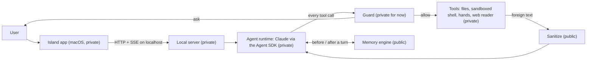

# Koob

A personal assistant for macOS that lives in the MacBook notch, talks by text and voice, and has hands on the Mac: it sees the screen, drives other apps, and opens its own task windows. This repository publishes the long-term memory engine and the text sanitizer, and documents the security model around every tool call.

<!-- DEMO: docs/media/demo video goes here -->

## What it does

- **Lives in the island.** A small animated cube under the notch. You type or speak; it answers in a line or two and carries the task through to the end.
- **Opens its own windows.** When a task needs more room than the island, Koob opens a task window it owns, keeps watching what happens in it, and acts inside it.
- **Has eyes and hands.** It reads the screen (screenshots and OCR with secrets redacted) and works other apps through the macOS Accessibility API, a sandboxed shell, and an isolated web reader.
- **Remembers.** A memory engine with provenance, versioning, sensitivity labels, and real forgetting, built spec-first (in progress; see [Status](#status)).
- **Is fast by design.** The target is the first word within 3 seconds, with simple commands answered by code before any model is called.

The brain is Claude, driven through the Claude Agent SDK; one SDK session per conversation, with Koob's own tools served over MCP. Small local models handle instant first lines and speech recognition on the Mac.

## Security model

An assistant with hands on a personal Mac reads a lot of text that is not the user's: web pages, mail, messages, files, the screen, other people's speech. Koob treats all of it as data, never as instructions. A single gate, `tool_verdict()`, decides every tool call: allow, ask, or refuse.

- **Foreign text gives no orders.** After foreign text enters a conversation, the gate compares each outward or irreversible step against the user's own words; a step the user did not order, or a recipient the user did not point to, goes back to the user first.
- **Secrets never reach the model.** Secret files, keychains, password managers, and browser credential stores are refused even on the user's order; secrets are redacted on every text path; the shell runs in a macOS Seatbelt sandbox that cannot read them. The user types passwords and captchas.
- **Money is the one always-confirmed action.** Everything else the user orders runs at once with a one-line report and an Undo where possible. A payment, transfer, or paid subscription always stops for an editable confirmation.
- **Graded exams are off-limits.** While a graded test is in front, every tool is refused; practice is unlimited.

The full threat model, with what is enforced in code and what is prompt-level policy, is in [docs/security-model.md](docs/security-model.md).

## What's in this repository

Selected components of Koob, exported from the private codebase. The macOS island app (Swift), voice, screen control, Telegram, and the local web runtime are private for now.

| Path | What |
|---|---|
| `src/koob/sanitize.py` | Untrusted text to bounded plain text: HTML stripping, Unicode normalization, injection flags, secret redaction |
| `src/koob/memory/` | The memory engine: SQLite ledger, admission policy, writers, recall, forgetting, evaluation harness |
| `migrations/memory/` | The memory schema |
| `tests/` | Sanitizer and memory tests |

Not here yet: the safety gate (`guard.py`) and its tests, because the gate is still wired to the author's own accounts, sites and folders and is being generalized for other users; [docs/security-model.md](docs/security-model.md) describes how it works. The memory engine is here without its sensitivity labeler (`labeler.py`), whose example phrases are being rewritten. The code is published for reading; the memory package has no imports outside itself, which a test enforces.

## Architecture at a glance



Details: [docs/architecture.md](docs/architecture.md).

## Tech stack

- Python 3.13, SQLite (FTS5), pydantic, FastAPI for the local server
- Claude through the Claude Agent SDK; tools over MCP
- Swift and Metal for the island app; macOS Accessibility for the hands (private)
- Local models through Ollama; speech recognition with Whisper on MLX (private)
- pytest, ruff

## Status

Early and in active development. One person uses it daily on one Mac; it is not packaged for other users. The interface speaks Russian today; English is planned. The memory engine is built behind a feature switch and is not yet the engine the running assistant uses; see [docs/memory.md](docs/memory.md) for what is built, what is planned, and what is not yet proven.

## Repository map

```
README.md
SECURITY.md
docs/
  security-model.md     threat model and what enforces it
  architecture.md       components and data flow
  memory.md             the memory engine: built vs. planned
src/koob/
  sanitize.py           untrusted text handling
  memory/               the memory engine (api.py is the only entry point)
migrations/memory/      memory schema
tests/
  memory/               memory tests, one directory per spec area
  test_sanitize*.py     sanitizer tests
```

## Acknowledgements

The island's shell (the notch window, its open/close state machine and its motion engine) is adapted from [Coucou](https://github.com/Louis-CFM/coucou) by Louis Raillé, used under the MIT License. Thanks to Louis for the most polished open-source notch interface out there. Coucou's name, its character, icons and sounds are not used: Koob has its own cube, sounds and views, and its own island design is planned to replace the borrowed shell. The island code is not in this repository; its third-party notice travels with it whenever it is published.

## License

No open-source license is granted; all rights reserved. The code is published for reading and review.
