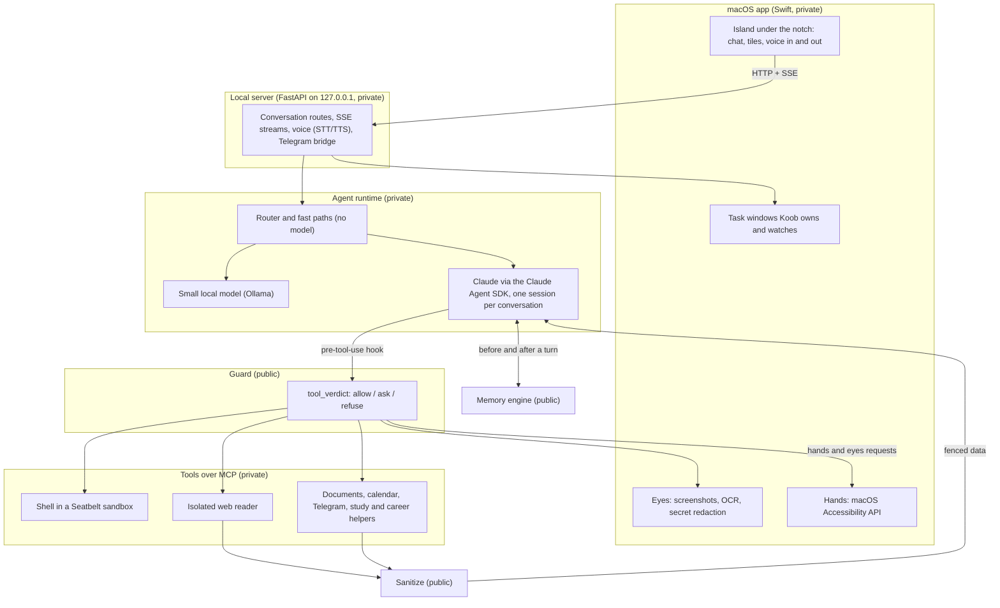

# Architecture

How Koob is put together, and where the public components sit in it. Components marked *private* are not in this repository.

## Components



### Island app (private)

A native Swift app: the island under the notch with the animated cube, chat, tiles, voice in and out, screen reading, and the hands. It talks to the local server over HTTP and server-sent events on localhost, and answers the server's requests to look at the screen or act in another app. Task windows are small windows the app opens for one tool each; Koob keeps reading their state so the user can ask about what they are looking at without explaining it. One window type is built; others are designed.

### Local server (private)

FastAPI, listening on 127.0.0.1 only. It owns the conversation routes and the streams back to the island, speech recognition and synthesis, and a Telegram bot bridge so the same assistant is reachable from the phone. Requests from other origins are refused and every POST carries a CSRF token.

### Agent runtime (private)

One turn is one call into the runtime. A router first tries to answer in code (no model). If the ask needs a model, a small local model gives an instant first line where that is reliable, and the conversation's Claude Agent SDK session is resumed with the core context and recalled memory. Koob's own tools are served to the session over MCP. Every tool call the model makes passes through the guard in the SDK's pre-tool-use hook before it runs.

### Guard (public)

`guard.py` (not published yet). `tool_verdict(tool_name, tool_input, state, target)` is the single entry point. It returns a `Verdict` with a decision (`allow`, `ask`, `override`, `deny`) and a reason in plain words, tracks per-conversation taint (foreign text, a look at the screen, speech in the room), and judges each action against the user's own words. See [security-model.md](security-model.md).

### Tools (private)

Server-side tools (documents, calendar, study and career helpers, Telegram), a shell that runs under a macOS Seatbelt sandbox that cannot read secrets or reach the app's own API, an isolated web reader whose output returns as data, and requests to the island app's hands and eyes.

### Sanitize (public)

`src/koob/sanitize.py`. Deterministic code, no model. Every piece of untrusted text (a page, a message, a file, a tool result) goes through it before it is fenced into a prompt: HTML to visible text, Unicode normalization, injection flags, fence-name neutering, and secret redaction.

### Memory engine (public)

`src/koob/memory/`. A SQLite ledger with versions, lineage, sensitivity labels, real forgetting, and a recall pipeline. The runtime reaches it only through `memory/api.py` and its adapters; the package imports nothing from the rest of Koob, and `tests/memory/test_boundaries.py` enforces that. See [memory.md](memory.md).

## A turn, end to end

```mermaid
sequenceDiagram
    participant U as User
    participant I as Island app
    participant S as Local server
    participant R as Runtime
    participant G as Guard
    participant T as Tool
    participant M as Memory

    U->>I: types or speaks
    I->>S: POST the text, open an SSE stream
    S->>R: start the turn
    R->>R: fast path in code? answer and stop
    R->>M: recall for this turn (before)
    R->>R: resume the Claude session with context and recall
    loop each tool call
        R->>G: tool_verdict(name, input, state, target)
        alt allow
            G->>T: run
            T-->>R: result (foreign text sanitized and fenced)
        else ask
            G-->>U: a card with the reason, editable
        else deny
            G-->>R: refused, with the reason
        end
    end
    R-->>S: text, tool status, cards stream back
    S-->>I: SSE; speech synthesized and played
    R->>M: after the turn: remember, fix, safety net
```

## Latency as a design goal

Koob treats speed as a product property, not polish: the stated target is the first word within 3 seconds and simple commands answered at once. The design choices that serve it: fast paths that answer in code without a model, a small local model for the first line, warm SDK sessions, and memory recall that runs in code (no model call) in parallel with the first word, with per-finder deadlines so a slow finder returns nothing rather than holding the turn.

These are goals and design decisions, not measured guarantees. Internal measurements on the voice path have come in well above the target in some cases, and speed remains open work.

## Data and privacy boundaries

- The server binds to localhost only; nothing listens on the network.
- Runtime data (databases, logs, backups, the assistant's working folder) lives outside the repository.
- Secrets live in a git-ignored `.env` or the macOS Keychain and are refused to the model (see [security-model.md](security-model.md#3-secrets-never-reach-the-model)).
- Speech recognition runs locally. Text sent to Claude is the conversation and the sanitized, redacted material the tools return.
- Memory items carry sensitivity labels; a job with no allowed processor for an item's labels waits rather than downgrading to a processor that is not allowed.
